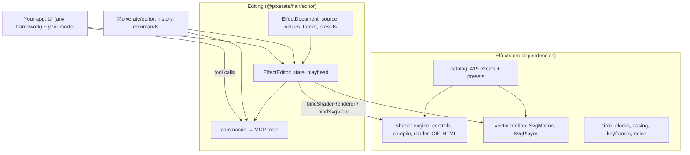

# @pixerate/flair

<p align="center">
  <strong>Visual effects and motion graphics for the web: WebGL2 shader effects, animated vector effects, a catalog of ready-made looks, and a UI-agnostic, agent-ready effect editor.</strong>
</p>

<p align="center">
  <a href="https://www.npmjs.com/package/@pixerate/flair"></a>
  <a href="https://github.com/Pixerate/flair/actions/workflows/ci.yml"></a>
  <a href="https://pixerate.github.io/flair/"></a>
  <a href="https://github.com/Pixerate/flair/blob/main/LICENSE"></a>
</p>

---

## 🌟 Overview

Flair gives products a library of good-looking, configurable visual effects (hero backgrounds, textures, light, image treatments, transitions, loaders, animated icons and charts) and the tools to make more of them, by hand or with an agent.

### Core Capabilities

- 🎨 **Effect catalog (`@pixerate/flair/catalog`)**: 419 effects, each with controls and presets, in 40 categories browsed in 8 groups. There are 280 WebGL2 shaders (gradients, organic textures and growth, patterns, light, lighting that relights pictures, space, 3D objects and globes, weather, water, atmosphere, retro and pixel art, image treatments, transparent overlays, text fills, image morphs, pointer interactions, sound- and scroll-driven effects, pyrotechnics, time warps, melting, electricity, splatters, bubbles, stickers, pointer trails, particles, debris, impacts, comic looks, glows, shadows, distortions, web UI flourishes and backgrounds, glass (glass and chrome text with a sweeping prism beam, a crystal ball, glass blocks, cracked glass, condensation, stained glass, a cut gem, a prism, dichroic panes) and mirrors (floor and water reflections, an infinity mirror, a funhouse mirror), transitions) and 139 animated SVG effects (text on a path and circle text, loaders and progress bars, status and animated icons, a logo marquee, a number ticker, animated titles, broadcast graphics and lower thirds, scroll-driven drawing, counters and steps, annotations and product-demo callouts, shape morphs, UI micro-interactions, pixel sprites, stickers, cartoon effects, glowing and lifting UI, a lamp switch, charts, counters, node graphs and other data viz). [Browse them live](https://pixerate.github.io/flair/).
- ⚡ **Shader engine**:
  - Shadertoy-style GLSL ES 3.00 fragment shaders, with controls declared in the source (`// @control`), including image inputs.
  - Compile errors come back with line numbers that match the source.
  - Pointer input beyond Shadertoy's `iMouse`: `iPointer` (position while over the canvas, eased hover amount, seconds held or since release) `iClicks[8]` (the latest clicks' positions and times) and `iTrail[32]` (where the pointer has been over the last second, newest first), so effects answer hovers, presses, taps and moves. `ShaderRenderer` and standalone pages feed them; `ShaderFrames` takes scripted `pointer`, `clicks` and `trail` for recordings.
  - Sound: `iAudio` (level, bass, mid, treble), `iSpectrum[16]` (64 log-spaced bins) and `iBeat` (seconds since the last beat). `ShaderRenderer.setAudioSource` listens to an `<audio>`/`<video>`, a microphone or any Web Audio node; `analyseAudioBuffer` analyses a decoded track offline, so recordings follow it frame for frame (see [Sound and scrolling](#sound-and-scrolling)).
  - Scrolling: `iScroll` (the canvas's progress through the viewport, page scroll, velocity, and whether it is scrolling), fed by `ShaderRenderer` and scriptable in `ShaderFrames`; vector effects scrub with the page under `trigger: "scroll"`.
  - Live previews (`ShaderRenderer`, with optional `{ alpha: true }` for transparent overlays) and many animated or hover-activated thumbnails on one context (`ThumbnailPool`).
  - Frames at exact times (`ShaderFrames`, on a page or in a Web Worker, out as `ImageData` or `ImageBitmap`), multi-pass effect stacks and feedback (`ShaderPipeline`, `effectStack`), looping GIFs, and standalone HTML pages.
- ✒️ **Vector motion (`@pixerate/flair/vector`)**: animated SVG described as data. Catalog vector effects declare their controls in the picture (`{{name: type …}}`), text included. A change's `ease` is `linear`, `out`, `in-out`, any CSS cubic-bezier as `[x1, y1, x2, y2]` (overshoot allowed), or a spring `{spring: {mass?, stiffness?, damping?, velocity?}}` (defaults 1, 170, 26, 0; it runs for the change's `ms`, then snaps to its end; `springSettleMs` gives a length that settles). A change can play `repeat` whole times (taking `ms × repeat`), with `alternate` running every other cycle backwards, and `strobe` holds its time on a grid of that many frames a second (12 for animation "on twos"). It covers attribute tweens, draw-on strokes, motion along paths, counters (`animateCount` / `formatCount` for DOM elements too), text written letter by letter (`write`, with `scramble` and `caret`), shape morphs between any paths (`morphPaths`, `morphSequence`) and view zooms. A change can also take a `behavior` (a pulse, a decaying oscillation, a seeded wriggle, a springy overshoot), and `orient` turns an element with the path it follows. Every frame is a pure function of time (`svgFrame`), and `SvgPlayer` plays it (with `scrollTrigger`, `hideWhenPaused`, `reset()`, and `trigger: "hover" | "press" | "click" | "scroll"` to play in answer to the pointer or scrub with the page).
- 🎞️ **Motion primitives (`@pixerate/flair/motion`)**: 23 reusable entrances, exits, emphasis and path motions for any element of a vector picture (see [Motion primitives](#motion-primitives)), described as data and expanded into plain vector motion.
- 🎛️ **Effect editor (`@pixerate/flair/editor`)**:
  - A headless editor for an effect's source, values, keyframes, presets and timeline.
  - Built on [`@pixerate/editor`](https://github.com/Pixerate/editor)'s undo history and command registry, with no UI framework assumed.
  - Opens animations made with `@pixerate/editor`'s vector animation editor (`effect.loadAnimation`, `effectDocumentFromAnimation`): shots over vector artwork become a vector effect, with the scene's colour controls and presets, so new effects can be animated there and finished here.
- 🤖 **Agent-native, bring your own model**:
  - Every editing action is a command, and the commands are exposed as MCP-shaped tools.
  - Ships instructions for the model. The host supplies the model, keys and agent loop.
- 🎬 **Directing and interchange**: multi-shot scenes with camera moves (3D tilt and motion blur included), procedural effects, validation and fast headless simulation. Also blend modes, Oklab colour and grading, retiming, timecode, and export to Lottie, Apple Motion, FCP7 XML and CMX 3600 EDL.

---

## 📦 Entry points

| Import | What it provides | Runtime dependencies |
| :--- | :--- | :--- |
| `@pixerate/flair` | Shader engine, vector motion, time and easing, colour, blending, transitions, scenes, interchange exporters | None (browser-safe) |
| `@pixerate/flair/catalog` | `EFFECTS`, `getEffect`, `findEffects` (also by `video` use), `effectDefaults`, `effectControlSchema`, `renderVectorEffect`, `vectorControls`, GLSL helpers, sample images, `textImage` | None |
| `@pixerate/flair/catalog/lazy` | The catalog loaded on demand: `EFFECT_META` (every effect's id, name, category, description, tags, controls, presets' names, inputs and video use), `findEffectMeta`, `getEffectMeta`, and `loadEffect(id)` for an effect's shader or picture | None |
| `@pixerate/flair/vector` | `SvgMotion`, `svgFrame`, `svgView`, `SvgPlayer`, `svgFrameMarkup`, `svgViewBox`, `animateCount`, `formatCount`, `morphPaths`, `morphSequence`, `svgAnimatedMarkup` (an animated `.svg` file), `svgMotionIssues` | None |
| `@pixerate/flair/motion` | Motion primitives: `PRIMITIVES` (entrances, exits, emphasis and path motions as JSON descriptors), `applyPrimitive`, `removePrimitive`, `primitiveTags` | None |
| `@pixerate/flair/embed` | `mountEffect`, `subjectValues`: any catalog effect on a page, applied to a picture, video, SVG, words or a path; `recordEffect`: MP4, WebM, GIF or PNG frames in the browser | None |
| `@pixerate/flair/react` | `<FlairEffect>`: any catalog effect applied to a subject; `<VectorEffect>`, `<SvgPlayerView>`: vector effects as React components, server-rendered as a still | `react` ≥ 18 (optional peer) |
| `@pixerate/flair/svelte` | `flairEffect` action: any catalog effect applied to a subject; `vectorEffect` action, `vectorEffectStill`: vector effects in Svelte, server-rendered as a still | `svelte` ≥ 5 (optional peer; types only) |
| `@pixerate/flair/editor` | `EffectEditor`, effect documents, keyframe tracks, renderer bindings, parameter-panel binding, agent tools and instructions, and `effectDocumentFromAnimation` / `loadAnimation` for scenes from `@pixerate/editor`'s animation editor | `@pixerate/editor` ≥ 0.55 (optional peer; only its dependency-free `/history`, `/commands`, `/tools`, `/animation`, `/animation-editor` and `/parameters` subpaths) |
| `@pixerate/flair/integrations` | `flairEffects()`: Flair's catalog and motion primitives as an effects provider for `@pixerate/editor`'s editors (its `@pixerate/editor/effects` contract) | `@pixerate/editor` ≥ 0.124 (optional peer, the first version with `/effects`; only that dependency-free subpath) |
| `@pixerate/flair/testing` | `installFakeWebGl`, `FakeGl`: a fake WebGL2 context, so code that renders with Flair runs in jsdom, Node or CI with the same pixels every time (any test runner) | None |
| `@pixerate/flair/node` | `exportEffect` and `exportMotionGraphic`: render a catalog effect (on a picture, video, SVG, words or a path) or a shader to MP4, WebM, MOV, GIF, PNG frames or animated SVG, through headless Chrome (and ffmpeg for video) | Node.js |

The `flair` CLI inspects shaders, writes standalone pages and directs scenes (see [CLI](#-cli)).

---

## 🏗️ Architecture



Flair stays free of LLM SDKs and UI frameworks. Your app owns the interface and the model. Flair owns the rendering, the effect model and the tool surface.

---

## 🚀 Quickstart

```bash
npm install @pixerate/flair
# For the editor:
npm install @pixerate/flair @pixerate/editor
# For the ready-made React (or Svelte) controls panel:
npm install @pixerate/editor-react
```

### 1. Drop in a catalog effect

```ts
import { ShaderRenderer, SvgPlayer, ThumbnailPool, animateCount } from "@pixerate/flair";
import { getEffect, effectDefaults, renderVectorEffect } from "@pixerate/flair/catalog";

// A shader background (overlay effects have `transparent: true`: render them with { alpha: true })
const aurora = getEffect("aurora")!;
if (aurora.kind === "shader") {
  const preview = new ShaderRenderer(document.querySelector("#hero")!);
  preview.setSource(aurora.source);
  preview.setValues(effectDefaults(aurora, { preset: "Ember", values: { uSpeed: 0.5 } }));
}

// Many shader cards sharing one WebGL context, animating only while hovered
const pool = new ThumbnailPool({ hoverOnly: true });

// An animated SVG effect, with scroll-triggered playback or hover reset (hideWhenPaused + reset())
const spinner = getEffect("spinner")!;
if (spinner.kind === "vector") {
  new SvgPlayer(document.querySelector("#loading")!, renderVectorEffect(spinner, { accent: "#0ea5e9" }), {
    hold: spinner.hold,
  });
}

// Standalone DOM number counter using Flair's clock and easing curves
animateCount({
  element: document.querySelector("#year")!,
  from: 2010,
  to: 2026,
  ms: 900,
  ease: "out",
});
```

With `loop: false` a player plays once and stays on its last frame (like CSS `animation-fill-mode: forwards`); add `hideWhenPaused` to hide it at the end instead.

Text effects (`category: "text"`) can sit inside a heading:

- **`inline: true`** frames just the text, from cap height to baseline. The backdrop is hidden, and outlines, glows, underlines and drips spill over the text around it. Inline text keeps its full size at any length: the picture gets wider instead of the text shrinking. Give the container `display: inline-block`, `height: 0.72em` and the viewBox's aspect ratio.
- **Overhang**: each text effect writes `data-overhang="top right bottom left"` (in ems) on its `<svg>`, saying how far it reaches past its box when it comes to rest. `svgInlineLayout(motion.svg)` (from `@pixerate/flair/vector`) reads the aspect ratio and the overhang. Use the overhang as a margin to keep room for drips and glows.
- **Typeface**: every text effect takes `font` and `weight`, and `font: "inherit"` uses the heading's font.
- **Colour**: colour controls take any CSS hex, `rgb()` or `hsl()` colour, or `currentColor` to follow the text colour around it, so one effect suits light and dark themes. Effects whose default text is light on a dark backdrop need an ink colour that shows on your page.

```ts
const motion = renderVectorEffect(getEffect("drip-text") as VectorEffect, { word: "Slop", inline: true, font: "inherit", outline: "currentColor" });
const { aspectRatio, overhang: o } = svgInlineLayout(motion.svg)!;
Object.assign(host.style, { display: "inline-block", height: "0.72em", aspectRatio: `${aspectRatio}`, margin: `${o.top}em ${o.right}em ${o.bottom}em ${o.left}em` });
new SvgPlayer(host, motion, { loop: false });
```

Find effects with `findEffects({ text: "glow", category: "light", kind: "shader" })`, or by a group of related categories with `findEffects({ group: "Backgrounds" })` (`EFFECT_CATEGORY_GROUPS` lists them, and `categoryGroup(category)` gives a category's group). Each effect has an `id`, `name`, `description`, `category`, `tags` and optional `presets`. Tags cut across categories: `findEffects({ tags: ["glass"] })` gathers every glass look (text, panes, lenses, stained glass, a prism) and `tags: ["reflection"]` every mirror. Image effects default to built-in sample pictures, so they look right before you set `uImage` to your own URL.

#### What an effect takes

`effectInputs(effect)` says what you can give an effect and how it answers the pointer, worked out from the effect itself:

```ts
import { effectInputs, findEffects, getEffect, textImage } from "@pixerate/flair/catalog";

effectInputs(getEffect("image-duotone")!);
// { accepts: ["image", "video", "svg"], images: [{ name: "uImage", wants: "picture" }], video: "filter", interactions: [], transparent: false, … }
effectInputs(getEffect("typewriter")!);
// { accepts: ["text"], texts: [{ name: "text", holds: "copy" }, { name: "font", holds: "font" }], interactions: [], … }
effectInputs(getEffect("click-ripple")!).interactions; // ["click"]

findEffects({ accepts: ["video"] }); // effects that run on video
findEffects({ accepts: ["text"], kind: "vector" }); // animated titles and labels
findEffects({ accepts: ["image"], interaction: ["hover"] }); // pictures that react to hovering
findEffects({ transparent: true }); // overlays to lay over a page, picture or video
```

- `accepts`: `image` (any picture URL), `video` (a live `<video>`, with `setLiveSource`), `svg` (an SVG URL, drawn with its transparency), `text` (words for a text control, or for a text mask through `textImage("…")`), `mask` (a shape with transparency whose silhouette the effect uses: an icon, a logo, a word), `path` (SVG path data for a shape control), `audio` (sound it reacts to, from reading `iAudio`, `iSpectrum` or `iBeat`).
- `images`: each image control's name, and whether it `wants` a `picture`, a `mask` or `text`.
- `texts`: each text control's name, and whether it `holds` `copy`, a `font`, a `path` or `glyphs`.
- `interactions`: `hover`, `press`, `click`, `trail` (follows where the pointer has been), `pointer` (follows where it is) or `scroll` (follows the page's scrolling), from the pointer and scroll built-ins a shader reads or a vector effect's `trigger`.
- `transparent`, `video` and `trigger`, as on the effect.

`findEffects` filters on `accepts` (all of them), `interaction` (any of them; `[]` for effects that don't answer the pointer) and `transparent`, and the `catalog.search` command takes the same filters and lists each effect's `accepts` and `interactions`. The `interactive` tag is kept in step with `interactions`.

#### Put an effect on a page

`@pixerate/flair/embed` pairs a catalog effect with what it takes and runs it, shader or vector, in one call. `mountEffect(host, effect, { subject })` takes a subject:
- `{ image }`: a picture's URL.
- `{ video }`: a playing `<video>`, shown live.
- `{ svg }`: an SVG, as markup or a URL.
- `{ text }`: words, typed into a vector effect, or drawn with `textImage` for a shader's text or mask.
- `{ path }`: path data.
- `{ audio }`: sound for an audio-reactive shader: a playing `<audio>` or `<video>` (still heard), a microphone's `MediaStream` (not played back) or a Web Audio node.

It puts the subject in the right control (see `effectInputs`) and throws a sentence if the effect can't take it.

```ts
import { mountEffect } from "@pixerate/flair/embed";

mountEffect(el, "image-duotone", { subject: { image: "/team.jpg" }, preset: "Spotify" });
mountEffect(el, "crt", { subject: { video: document.querySelector("video")! } });
mountEffect(el, "neon-outline", { subject: { svg: logoMarkup } });
mountEffect(el, "typewriter", { subject: { text: "Hello there" } });
mountEffect(el, "transition-wipe", { subject: [{ image: "/a.jpg" }, { image: "/b.jpg" }] });
mountEffect(el, "spectrum-bars", { subject: { audio: document.querySelector("audio")! } });
mountEffect(el, "scroll-draw"); // scroll effects follow the page by themselves
const m = mountEffect(el, "click-ripple"); // overlays get a transparent canvas, interactive effects answer the pointer
m.setValues({ uSpeed: 2 });
m.dispose();
```

`subjectValues(effect, subject)` gives the control values (and live sources) without mounting anything, for `ShaderRenderer`, `ShaderFrames` or `renderVectorEffect`.

In React, `<FlairEffect effect="image-duotone" subject={{ image: "/team.jpg" }} style={{ aspectRatio: "16 / 9" }} />` (from `@pixerate/flair/react`) does the same. In Svelte, use `<div use:flairEffect={{ effect, subject }}></div>` (from `@pixerate/flair/svelte`). Either way the effect fills its element, so size it with CSS.

Effects that show a picture (image, transition, morph, time-warp and the like) take transparent pictures too, such as SVG icons (Lucide and similar sets draw black `currentColor` strokes on a clear background). They lay the picture over a backdrop: `uBackdrop` (white by default) shows through its clear parts. Set `uBackdropAlpha` to 0 to keep the picture's alpha instead, and render with `{ alpha: true }` to lay the result over the page. `SAMPLE_IMAGES.icon` is a Lucide-style sample icon. SVGs are rasterised at 2048 px on the long edge, so icons stay sharp.

#### Recording an effect

`recordEffect(effect, options)` (from `@pixerate/flair/embed`) records a catalog effect, applied to a subject, to a file in the browser, with no server and no extra dependencies:

```ts
import { recordEffect } from "@pixerate/flair/embed";

const mp4 = await recordEffect("image-duotone", { subject: { image: "/team.jpg" }, preset: "Spotify" });
const webm = await recordEffect("crt", { subject: { video }, format: "webm", duration: 5 });
const music = await recordEffect("spectrum-bars", { audio: "/song.mp3", duration: 10 }); // the sound drives it and is muxed in
const gif = await recordEffect("typewriter", { subject: { text: "Hello there" }, format: "gif", width: 640, height: 360, fps: 25 });
const overlay = await recordEffect("click-ripple", {
  format: "webm",
  alpha: true,
  pointer: { clicks: [{ x: 640, y: 360, time: 0.2 }] }, // or (t) => ({ pointer: [x, y, hover, press] })
  onProgress: (f) => (bar.value = f),
});
download(mp4); // a Blob
```

- **Formats.** `mp4` (H.264) or `webm` (VP9, else VP8) are encoded with WebCodecs and written by small built-in muxers: a faststart MP4 (`moov` before `mdat`) and a WebM with no `Cues`. `gif` uses gifenc. `png` gives a ZIP of numbered frames (`frame-0001.png`, …), so every format is one `Blob`. The default is `mp4` where the browser encodes H.264, else `webm`. When the browser can't make a format, it rejects with a sentence that names the formats that would work.
- **Exact frames.** Frame `i` is drawn at `start + i / fps` off screen, so the result is the same whatever the page is doing. Shaders render with `ShaderFrames`. A `<video>` subject is paused and sought to each frame's time, then put back. A canvas subject is drawn as it is, so draw it for each frame in `beforeFrame(time)`. Vector effects are drawn with `svgView` and rasterised.
- **Defaults.** 1280 × 720 at 30 fps. The length is a shader's `loop`, or a vector effect's picture plus its `hold`, else 4 s. The bitrate is `width × height × fps × 0.15`. Video sizes round up to even numbers. `recordingPlan(effect, options)` tells you what a recording will be (format, size, frames, encoder) before any frame is drawn.
- **Interaction.** Shaders that answer the pointer play their idle demo unless `pointer` scripts it, with the same `pointer`, `clicks` and `trail` that `ShaderFrames.render` takes. Click-triggered vector effects take `steps` (ms). Scroll effects play their idle demos too.
- **Sound.** `audio` takes a decoded `AudioBuffer` or an audio file's URL (fetched and decoded at 48 kHz). Audio-reactive shaders follow it frame for frame: each frame's `iAudio`, `iSpectrum` and `iBeat` come from `analyseAudioBuffer` at that frame's time, so the same file always makes the same video. The stretch from `start` to `start + duration` becomes the video's sound track: AAC in an `mp4`, Opus in a `webm` (encoded with WebCodecs' `AudioEncoder`, muxed by the same built-in muxers). Where the browser has no AAC encoder, the default format falls back to `webm`, and an explicit `mp4` is refused with a sentence. Pass `audioTrack: false` for the picture alone. `gif` and `png` have no sound, so there the audio only drives the picture.
- **Transparency.** `alpha` defaults to the effect's `transparent`. It is kept in `webm` (VP9/VP8 with an alpha channel, encoded as a second stream and stored as `BlockAdditions`, as Chrome does), in `png`, and in `gif` (one see-through colour, so edges are hard). An `mp4` has no alpha, so asking for both is refused. When alpha is off, transparent pixels are laid over `background` (black for shaders, white for vector effects).

Limits: video needs WebCodecs (Chrome and Edge 94+, Safari 16.4+ for H.264, and Firefox 130+). Safari doesn't play alpha WebM, so use PNG frames there. Everything is held in memory until the end, so record long or 4K clips in parts. Vector effects are rasterised once per frame, which is slower than shaders. A picture from another site needs CORS, as on screen.

#### Effects on video

Image controls can show a playing `<video>` (or a canvas) instead of a picture. `setLiveSource(name, video)` puts it in the control named `name`. The video's current frame is uploaded each time it changes, and a paused preview still follows the video. The renderer never plays, seeks or loops the video itself. The control's value keeps its URL, so documents, presets and agents still see a plain string.

```ts
const crt = getEffect("crt") as ShaderEffect;
const video = Object.assign(document.createElement("video"), { src: "/clip.mp4", muted: true, loop: true, crossOrigin: "anonymous" });
await video.play();
const preview = new ShaderRenderer(host);
preview.setSource(crt.source);
preview.setLiveSource("uImage", video); // null goes back to the URL
```

Each shader with an image control has a `video` field that says how it suits video:

- `filter`: treats each frame on its own, so it works as a live filter (CRT, film look, duotone, glitch, ASCII and others).
- `transition`: blends two pictures, so it works between two clips (put one video in `uFrom` and one in `uTo`).
- `interactive`: reacts to the pointer, and works over video too (magnifier, hover reveal and others).
- `stills`: runs on video but is made for a still picture. Time-warp effects move the picture to fake motion of their own, and the morph effects need shapes in fixed places.
- `none`: its picture is rendered text or a silhouette mask.

`findEffects({ video: ["filter", "transition"] })` lists the effects that suit video. The `catalog.search` command takes the same filter.

A video from another site needs `crossOrigin = "anonymous"` and that site's CORS consent. Without it, the control shows black and `onImageError` explains why. For frame-exact output, step the video with `ShaderFrames`: pause the video, then for each frame `await seekVideo(video, t); frames.render(t)`. Both `ShaderRenderer.ready()` and `ShaderFrames.ready()` wait for each live video's first frame.

#### Pixels in and out, and Web Workers

Image controls also take pictures that are not on the page: an `ImageBitmap`, a WebCodecs `VideoFrame`, an `ImageData` or an `OffscreenCanvas`. A canvas is uploaded on every frame; a still is uploaded once, so pass the next picture to `setLiveSource` before each frame that should show it (the same object again uploads its changed pixels). A `VideoFrame` stays yours to `close()` once the frame that shows it has been rendered.

`ShaderFrames` runs in a Web Worker as it does on a page. Give it an `OffscreenCanvas` (or let it make one where there is no `document`), and take each frame out with `readImageData()` (RGBA, 8 bits a channel, rows top down, sRGB, not premultiplied: an `ImageData`) or `await toImageBitmap()`, which a Worker can transfer to the page without copying. In a Worker, image URLs load with `fetch` and `createImageBitmap`. SVG URLs cannot be decoded there: rasterise them on the page and pass the bitmap.

```ts
// worker.ts
import { ShaderFrames } from "@pixerate/flair";
const frames = new ShaderFrames({ source, width: 1920, height: 1080, canvas: new OffscreenCanvas(1920, 1080) });
self.onmessage = async ({ data: { time, frame } }: MessageEvent<{ time: number; frame: VideoFrame }>) => {
  frames.setLiveSource("uImage", frame);
  frames.render(time);
  frame.close();
  const bitmap = await frames.toImageBitmap();
  self.postMessage(bitmap, [bitmap]);
};
```

The demo's `#pixels` page checks that each kind of picture arrives the right way up, on the page and in a Worker, and times a 1080p frame rendered and read out each way.

#### Effect stacks and feedback

`ShaderPipeline` renders several shaders as one picture on one WebGL2 context. Each pass draws into a texture of its own, and the last pass is the output (on `canvas`, or from `readImageData()` / `toImageBitmap()`). A pass's image controls take their pictures from:

- `"previous"`: the pass before.
- `{ pass: n }`: another pass's output (the frame before's, for a later pass).
- `"feedback"`: the pass's own last frame, for trails, echoes and anything that builds on itself.
- A picture, as with `setLiveSource`.

`blend: "over"` draws a pass over the one before by its alpha, for overlays. `effectStack` (from the catalog) turns catalog shaders into passes: each filter reads the layer below, and overlays are drawn over it.

```ts
import { ShaderPipeline } from "@pixerate/flair";
import { effectStack } from "@pixerate/flair/catalog";

const stack = new ShaderPipeline({ passes: effectStack(["aurora", "crt", "vignette-grain"]), width: 1280, height: 720 });
stack.render(2.5);

// A trail: each frame mixes the pointer's glow into the frame before.
const trail = new ShaderPipeline({
  passes: [{ source: `uniform sampler2D uLast; // @control filter=linear wrap=clamp
void mainImage(out vec4 c, in vec2 f) {
  vec4 last = texture(uLast, f / iResolution.xy) * 0.94;
  c = max(last, vec4(smoothstep(24.0, 0.0, distance(f, iPointer.xy))));
}`, inputs: { uLast: "feedback" } }],
  width: 640, height: 360,
});
```

With feedback, a frame depends on the frames before it, so render them in order from the start (or from `resetFeedback()`) to get the same frames every time. Each pass costs about one draw plus a mipmap; at 1080p, a three-effect stack measured within a millisecond of a single `ShaderFrames`.

##### Masks and regions

`setMask(mask)` (or the `mask` option) limits where a pipeline's effect applies, on the GPU.

- **Coverage** comes from a picture's alpha (or its luminance, with `channel: "luminance"`), stretched to the output.
- **A region** is a rectangle in output pixels from the top left, with a soft edge `feather` pixels wide. Given both, coverage is the picture's times the region's.
- **`invert`** turns coverage round.
- **Where coverage is 0, `under` shows.** That's usually the picture the effect changes, either given directly or as `{ pass: n }` for a pass's output. Without `under`, coverage multiplies the output's alpha instead, as for a generator laid over something else.

0 means untouched and 1 means the full effect, as with `@pixerate/editor/effects`' render `mask`.

```ts
const filtered = new ShaderPipeline({
  passes: effectStack(["crt"], { source: photo }),
  width, height,
  mask: { picture: selection, under: photo }, // the CRT look only where the selection is
});
filtered.setMask({ region: [40, 40, 320, 180], feather: 12, under: photo });
```

##### In a host's WebGL context

A compositor or editor that draws with WebGL2 can give the pipeline its own context (`gl`) and keep frames on the GPU, with no read back:

- The host's textures go into image controls as `{ texture, width, height }` (rows bottom up). They are copied at each render, and their own filtering is left alone.
- The output is `outputTexture`, ready to sample, or it can be drawn into a framebuffer of the host's with `render(t, { target })`.

After every call the pipeline leaves the host's state as it found it: framebuffers, viewport, program, texture units, vertex array, scissor, depth, stencil, culling, blending, colour mask, clear colour and unpack flags. `dispose()` frees only what the pipeline made. At 1080p, drawing a two-effect stack into a host framebuffer measured 0.5 ms a frame, against 6.7 ms to read it back and upload it again.

```ts
const pipeline = new ShaderPipeline({ passes: effectStack(["crt"]), width, height, gl: hostGl });
pipeline.setInput(0, "uImage", { texture: layerTexture, width, height });
pipeline.render(t, { target: hostFramebuffer }); // or sample pipeline.outputTexture
```

##### Float layers, colour and alpha

`format: "rgba16f"` or `"rgba32f"` makes every pass draw into float textures, for 16- and 32-bit layers and HDR. The default is `"rgba8"`. Float formats need `EXT_color_buffer_float`, and `"rgba32f"` also needs `OES_texture_float_linear`; without them the constructor says which to use instead. The contract:

- **Shaders see sRGB-encoded colour in every format**, as they are written, so an effect looks the same at any depth. In a float format, values keep their precision between passes and may go above 1 or below 0.
- **8-bit in and out** (`readPixels`, `readImageData`, pictures in image controls) are sRGB-encoded, with straight (not premultiplied) alpha, as `ImageData` is.
- **Float in and out** are in **linear light** (sRGB primaries), with straight alpha. Colour may exceed 1, the same as `@pixerate/editor/effects`' `EffectPixels.float`. A float picture `{ width, height, data: Float32Array }` (rows top down) goes into an image control like any other input. `readFloatPixels()` gives the output.
- **Conversion runs on the GPU**, with the sRGB curves extended past 0–1 (sign-preserving), so HDR survives: an output of 2.0 reads back as 4.95 in linear light.

Overlay shaders (`category: "overlay"`) have `transparent: true`: they write coverage to `fragColor.a` and draw nothing elsewhere, so render them with `new ShaderRenderer(host, { alpha: true })` (or `new ThumbnailPool({ alpha: true })`) and lay the canvas over a picture, video or page. Some overlays are added light: give `glare-sweep`'s canvas `mix-blend-mode: plus-lighter` and it adds exactly (over `image-duotone`, that is the duotone with the gliding glare it used to have built in). Interaction effects answer the pointer. Interactive shaders read `iPointer` and `iClicks`, so they work in any `ShaderRenderer` with no wiring, and play an idle demo when nobody is pointing (turn off "Demo when idle" to stop it). Vector micro-interactions carry a `trigger`: pass it to the player, `new SvgPlayer(host, renderVectorEffect(effect), { trigger: effect.trigger })`. A hover or press trigger plays to the end while hovered or held and back again after; a click trigger plays the next step on each click, so toggles turn on and off. Hosts can drive them too, with `player.setActive(on)` and `player.advance()` (from a keyboard handler, say).

To morph between any two SVG shapes, `morphPaths(from, to)` (from `@pixerate/flair/vector`) returns two paths with one structure, so `attrs: { d: [a, b] }` blends them point by point: curves and arcs are read, pieces are paired by position and size, and a piece with no partner grows from or shrinks to a point (draw them with `fill-rule="evenodd"`). `morphSequence` does the same for three or more shapes. `feature-morph` morphs two photos from five matching points, and `silhouette-morph` morphs any two silhouettes or logos (or words, through `textImage`).

#### Motion primitives

`@pixerate/flair/motion` holds the motion vocabulary as data: reusable entrances, exits, emphasis and path motions that work on any element of an `SvgMotion`. Each primitive is a JSON descriptor (`id`, `kind`, `description`, `params` with labels, defaults, units and ranges, and a default `ms` and `ease`), so people and agents can list and describe them without running anything; the expansion behind each id is a pure function.

| Kind | Primitives |
| :--- | :--- |
| Entrance (600 ms, ease out) | `entrance.fade`, `.pop`, `.grow`, `.slide` (direction, distance), `.wipe` (direction), `.iris` (circle or box), `.split` (horizontal or vertical), `.zoom`, `.rise`, `.draw` (outline on, then the fill) |
| Exit (450 ms, ease in) | `exit.fade`, `.shrink`, `.slide`, `.wipe` (a wipe in reversed), `.undraw` |
| Emphasis | `emphasis.pulse`, `.shake` (settles), `.teeter`, `.wave`, `.color-pulse`, `.spin`, `.wiggle` (seeded noise) |
| Path | `path.follow` (along a path id, `orient`, from/to fractions), `path.text` (a `<text>`'s words set along a `<path>` by id, moving from/to fractions of its length, `lift` off it) |

```ts
import { applyPrimitive, removePrimitive, PRIMITIVES } from "@pixerate/flair/motion";

let motion = { svg: '<svg viewBox="0 0 200 100"><rect id="card" x="10" y="10" width="80" height="40"/></svg>' };
const pop = applyPrimitive(motion, { primitive: "entrance.pop", target: "card" });
if (pop.ok) motion = pop.motion; // else pop.message says what to fix ("Did you mean …?")
const pulse = applyPrimitive(motion, { primitive: "emphasis.pulse", target: "card", delay: 800, params: { count: 2 } });
// pulse.tag ("emphasis.pulse@card") takes it off again: removePrimitive(motion, pulse.tag)
```

A use is checked whole (primitive, target id, params, timing) before anything changes, and applies all or nothing. The result is plain `SvgAnimation`s (tagged with the use) and, where needed, a wrapper group round the element (so uses stack: an entrance, emphasis and an exit each move their own group) or a clip path in the element's own box (wipes, irises and splits, so text needs no measuring). Primitives that scale or turn round the centre measure the element's box from the markup; give `box` (viewBox units) for text. Emphasis takes `repeat` and `alternate` too. Defaults match `@pixerate/editor`'s animation editor.

#### An animated SVG file

`svgAnimatedMarkup(motion, options)` (from `@pixerate/flair/vector`) writes any `SvgMotion` as one self-contained `.svg` that plays and loops on its own, with no script and no player: put it in an ``, open it as a file, or inline it. The changes are written as SMIL, so it needs no DOM to make:

```ts
import { effectDefaults, getEffect, renderVectorEffect, type VectorEffect } from "@pixerate/flair/catalog";
import { svgAnimatedMarkup } from "@pixerate/flair/vector";

const effect = getEffect("stat-counter") as VectorEffect;
const svg = svgAnimatedMarkup(renderVectorEffect(effect, effectDefaults(effect)), { hold: effect.hold })!;
img.src = `data:image/svg+xml,${encodeURIComponent(svg)}`; // or save it as stat-counter.svg
```

- **Options**: `hold` (ms on the last frame, default 600), `duration` (the loop, default the picture's length plus `hold`), `loop: false` to play once and stay on the last frame, `steps` (ms) for click-triggered effects, `fps` (default 30) for what is sampled, and `idSuffix`.
- **How it is written**: each attribute change is one `<animate>` (a `transform` is one `<animateTransform>` per function), and eases are exact `keySplines` (a cubic-bezier `ease` is written as given, unless it overshoots 0–1, which SMIL cannot spline, so it is sampled). Repeated cycles are written cycle by cycle (an alternating one with its spline turned round), a `strobe` as exact held frames, and a spring ease is sampled at `fps`. `draw` animates `stroke-dashoffset`, `along` becomes `<animateMotion>` on the path, `view` animates the `viewBox` (keeping `data-fixed` and `data-nonscaling` elements as the player does), and `solo` toggles `display`. Counts and written text are one `<tspan>` per text, shown in turn, sampled at `fps`. Every element starts on the first frame, so it still shows that where SMIL does not run.
- **Limits**: a count that changes faster than `fps` can be up to half a sample out. A change cut short by the next one, or a `matrix` transform, is sampled. A `view` that frames an element by id (it needs layout) is left out, as in `svgFrameMarkup`. Attributes SMIL cannot blend change in steps. Ids the picture refers to (gradients, filters, paths followed) get a suffix, a hash of the motion by default, so two files inlined in one page don't clash. `#id` selectors in a `<style>` are not renamed. Interaction triggers (hover, press, click) cannot be written as SMIL, so a click-triggered effect plays its `steps` on a timer.
- **Size**: catalog effects come out at 1 to 105 KB (`drip-text` is the largest).

### React

`@pixerate/flair/react` wraps the player, so a page needs no ref, effect or dispose of its own. `<VectorEffect>` plays a catalog vector effect by id, `<SvgPlayerView>` any `SvgMotion`:

```tsx
import { VectorEffect } from "@pixerate/flair/react";

<h1>
  Stop the <VectorEffect id="drip-text" values={{ word: "Slop", inline: true, font: "inherit" }} loop={false} />
</h1>;
```

- **Server rendering**: both render a still of the last frame as markup (`"first"` for hover and press triggers; set `poster` for another), sized from the viewBox, so the page hydrates with the picture in place. The `SvgPlayer` takes over after mount and is disposed on unmount.
- **Reduced motion**: under `prefers-reduced-motion: reduce` the still stays. `reducedMotion="always"` or `"never"` overrides it.
- **Size**: a block as wide as its container, with the viewBox's aspect ratio. With `inline` (or an effect whose `inline` control is on) it is an `inline-block` 0.72em high, sitting on the baseline like a capital letter; pass a CSS length to `inline` for another height. Add `contain` to keep room for what spills past the text (a margin of its overhang).
- **Plays when seen**: an effect that plays once (`loop={false}`, no trigger) waits until it is scrolled into view, so one further down the page doesn't finish before anyone sees it. Pass `playOnEnter={false}` to start at mount.
- **Props**: player options (`loop`, `autoplay`, `speed`, `hold`, `trigger`, `steps`, `pauseWhenHidden`, `playOnEnter`, `clock` …), `values` and `preset` for an effect, `onPlayer` for the player itself, and any `<span>` attribute (`elementId` sets the host's `id` on `<VectorEffect>`). Values are compared by content, so an inline object does not restart it; pass `<SvgPlayerView>` a memoised `motion`.

Without React or Svelte, `svgFrameMarkup(motion, { at: "last" })` (from `@pixerate/flair/vector`) gives the same still as safe `<svg>` markup with no DOM, for any server or framework.

### Svelte

`@pixerate/flair/svelte` does the same for Svelte 5, as plain TypeScript (no `.svelte` files, so nothing to compile). The `vectorEffect` action plays an effect by `id` (or any `motion`) in its element, and `vectorEffectStill` gives the server-rendered still:

```svelte
<script>
  import { vectorEffect, vectorEffectStill } from "@pixerate/flair/svelte";

  let { word = "Slop" } = $props();
  const params = $derived({ id: "drip-text", values: { word, inline: true, font: "inherit" }, loop: false });
  const still = $derived(vectorEffectStill(params));
</script>

<h1>Stop the <span use:vectorEffect={params} style={still.style}>{@html still.markup}</span></h1>
```

- **Params**: the React props, as one object: `id` with `values` and `preset`, or `motion`; player options; `poster`, `reducedMotion`, `inline`, `contain`, `onPlayer`. An effect that plays once waits until it is scrolled into view, as in React. A change remakes the player (values by content; `speed` without remaking), and it is disposed when the element goes.
- **Still**: `markup` is the still's layer and `style` the host's size from the viewBox, with the same rules as React. The action hides the still while the player runs and keeps it under `prefers-reduced-motion`. Without `vectorEffectStill` it makes its own still and sizes the element on the client.
- **Attachments**: `{@attach fromAction(vectorEffect, () => params)}`, with `fromAction` from `svelte/attachments`.

`shader-text` fills letters from a text image: set its `uText` control to `textImage("Your title", { weight: 900 })`, a transparent SVG `data:` URL of any Unicode text.

A vector effect declares its controls in its picture, the way a shader declares its uniforms: the first `{{name: type …}}` declares a control (`float`, `int`, `bool`, `color` or `text`, with `@control`'s attributes; quote values with spaces in single quotes), and every `{{name}}` is filled with its value. Declarations can sit in an XML comment, which is dropped when the picture is filled in, and text is escaped, so any words are safe:

```ts
const title = { motion: { svg: `<svg viewBox="0 0 200 60"><!-- {{title: text default='Hello' label='Title'}} {{ink: color default=#6366F1}} --><text x="10" y="40" fill="{{ink}}">{{title}}</text></svg>` } };
vectorControls(title.motion); // [{ name: "title", type: "text", default: "Hello", … }, { name: "ink", type: "vec3", color: true, … }]
renderVectorEffect(title, { title: "Fish & chips" }); // …<text …>Fish &amp; chips</text>…
renderVectorEffect(getEffect("drip-text")!, { word: "UNSTOPPABLE" }); // drips follow the word
```

### 2. Write your own shader

```glsl
// Controls are uniforms annotated on the same line.
uniform vec3 uTint;    // @control color default=#77C16A label="Tint"
uniform float uSpeed;  // @control min=0 max=4 default=1 label="Speed"
uniform sampler2D uPhoto; // @control filter=linear wrap=clamp label="Photo"

void mainImage(out vec4 fragColor, in vec2 fragCoord) {
  vec2 uv = fragCoord / iResolution.xy;
  vec3 photo = texture(uPhoto, uv + 0.01 * sin(uv.yx * 20.0 + iTime * uSpeed)).rgb;
  fragColor = vec4(photo * uTint, 1.0);
}
```

```ts
import { ShaderRenderer, ShaderFrames, recordGif, standaloneHtml, parseControls } from "@pixerate/flair";

const status = renderer.setSource(source); // { ok, errors: [{ line, message }] }
parseControls(source); // [{ name: "uTint", type: "vec3", color: true, default: [...] }, ...]
const gif = await recordGif({ source, width: 480, height: 270, fps: 30, duration: 3 });
const frames = new ShaderFrames({ source, width: 480, height: 270, alpha: true }); // alpha: keep fragColor.a
frames.render(1.5);
frames.readImageData(); // or await frames.toImageBitmap()
const page = standaloneHtml("My effect", source, { uSpeed: 2 }); // { audio: "song.mp3" } or { audio: "mic" } for sound
```

### 3. Build an editor (any UI)

```ts
import { createEffectEditor, bindShaderRenderer, bindSvgView } from "@pixerate/flair/editor";
import { ShaderRenderer } from "@pixerate/flair";

const editor = createEffectEditor({ from: "nebula" });
const renderer = new ShaderRenderer(previewElement);
bindShaderRenderer(editor, renderer); // source, values at the playhead, time; compile errors flow back

editor.subscribe((state) => render(state)); // state: document, controls, values, issues, compile, time, history
editor.setValue("uDensity", 1.4); // checked and undoable; slider drags merge into one step
editor.setKeyframe("uSpeed", 2000, 0.2, "ease-in-out");
editor.applyPreset("Ember");
editor.play();
editor.undo();

// Menus, shortcuts and command palettes run the same commands by id:
editor.commands.execute("values.randomize");
window.addEventListener("keydown", (e) => editor.commands.handleKeyDown(e)); // Space plays/pauses
```

`getState()` returns the same object until something changes, so React's `useSyncExternalStore` works as is. Documents are plain JSON (`EffectDocument`). Keyframe tracks use `@pixerate/editor/animation`'s track shape and easing engine.

For a ready-made controls panel, bind the effect to `@pixerate/editor`'s parameters editor. Every field, image pick and keyframe diamond goes through the effect editor and its undo history:

```tsx
import { bindEffectParameters } from "@pixerate/flair/editor";
import { ParametersPanel } from "@pixerate/editor-react/parameters"; // or @pixerate/editor-svelte/parameters

const { controller, dispose } = bindEffectParameters(editor);
<ParametersPanel controller={controller} showToolbar={false} showPresets={false} showKeyframes />;
```

`parameterSchemaFor(controls)` gives you the schema alone, for a UI of your own.

### 4. Let an agent drive it

```ts
import { createEffectToolProvider, createEffectToolRegistry, toolDefinitions, callTool, EFFECT_AGENT_INSTRUCTIONS } from "@pixerate/flair/editor";

const tools = createEffectToolProvider(editor, {
  capture: () => renderer.capture({ type: "image/png" }), // adds a `view_effect` tool so the model can look
});

// Give your model EFFECT_AGENT_INSTRUCTIONS and toolDefinitions(tools), then for each tool call:
const result = await callTool(tools, call.name, call.input); // MCP tools/call result

// Or serve them through @pixerate/editor/tools' ToolRegistry (MCP tools/list and tools/call):
const registry = createEffectToolRegistry(editor); // registry.listTools(), registry.callTool(name, args)
```

The tools are `list_commands`, `run_command` and `run_commands`, plus `view_effect` when you can capture the preview. The commands they run:

- **Inspect and start:** `effect.describe`, `catalog.search` (`{ total, effects }`, 20 at a time unless you pass `limit`; `offset` pages on), `effect.load`.
- **Edit the effect:** `effect.setSource` for shaders (it returns the compile report when a preview is bound, or says the source has not been compiled yet), `effect.setMotion` for vector pictures.
- **Motion primitives** (vector pictures): `primitive.list` (by `kind`), `primitive.describe`, `primitive.apply` (returns the use's `tag` and the animations it added), `primitive.applied` and `primitive.remove`.
- **Values and presets:** `values.schema` (the JSON Schema of the effect's values), `values.set`, `values.reset`, `values.randomize`, `preset.apply` and `preset.save`.
- **Keyframes:** `keyframe.set`, `keyframe.setTrack`, `keyframe.remove`, `keyframe.setEasing` and `keyframe.clear`.
- **Timeline:** `timeline.setTiming`, `timeline.play`, `timeline.pause` and `timeline.seek`.
- **History:** `history.undo` and `history.redo`.

Every change is one undo step, and refusals come back as messages the model can act on.

### 4b. Effects in `@pixerate/editor`'s editors

`@pixerate/editor`'s editors take an effects provider, and `flairEffects()` is Flair's. The editor never imports Flair; the host passes the provider in.

```ts
import { flairEffects } from "@pixerate/flair/integrations";

editor.setEffectsProvider(flairEffects());

const provider = flairEffects();
const [wipe] = await provider.search("wipe", { use: "transition" });
const renderer = await provider.createRenderer(wipe.id, { width: 1920, height: 1080 });
const frame = await renderer.render({ time: 0, progress: 0.5, inputs: { from: clipA, to: clipB } }); // { width, height, data }
```

- **Catalog.** Every shader and vector effect, plus the motion primitives as `motion` effects. Metadata comes from the lazy catalog; an effect's source loads when it is described or rendered.
- **Uses and inputs.**
  - Video filters (and stills and interactive effects over a picture) are `filter`, and read the input `source`.
  - Transitions read `from` and `to`. `progress` (0–1, default `time / duration`) drives them in place of their own clock.
  - Overlays, titles, generators and interactive effects follow from the catalog's categories and inputs.
  - Other image controls are optional inputs named after their uniform (`uMask`, `uText`); without one, the effect shows its own sample.
- **Values.** Controls come as a strict JSON Schema, with colours as `#rrggbb`. A bad value is refused with `invalid_values`.
- **Rendering.**
  - Shaders render through a `ShaderPipeline`, on a page or in a Worker, and take `ImageBitmap`, `VideoFrame`, `OffscreenCanvas` or `{ width, height, data, float? }` inputs.
  - At `depth` 16 or 32 they render in half or full floats and also return `float` (linear light, straight alpha, as the contract defines it). Where the GPU cannot render to floats, frames are 8-bit and `depth` says so.
  - A `mask` is composited on the GPU over the untouched input (`source`, or a transition's `from`). With no input, coverage multiplies alpha.
  - Vector effects render on a page. In a Worker, pass `rasterizeSvg` or use `applyVectorEffect`. Their masks multiply alpha.
- **Vector.** `applyVectorEffect(id, target, values)` returns a vector effect's own animated SVG with its values filled in, or applies a motion primitive to the target's elements: `nodeIds`, or each top-level element with an id.

The demo's `#provider` page runs the editor's own conformance check (`checkEffectProvider`) over every effect on your GPU, and draws a few through the contract.

### 5. Let an agent direct a scene

Scenes have their own tools, `FLAIR_AGENT_TOOLS` (Anthropic-style `{ name, description, input_schema }`), applied by a pure state machine:

```ts
import { FLAIR_AGENT_TOOLS, applySceneTool } from "@pixerate/flair";

let scene = initialScene;
// Send FLAIR_AGENT_TOOLS to your model, then for each tool call:
const result = await applySceneTool(scene, call.name, call.input);
if (result.ok) scene = result.scene; // keep the new state
reply(call.id, result.output); // send the model only `output`
```

The tools are `get_scene` (the scene, or with `view: "outline"` just its structure), `write_scene`, `update_shot`, `insert_shots`, `delete_shots`, `set_media`, `set_rig_widget`, `preview_scene` (a headless run: length, warnings, notes) and `batch_scene`, which runs several of them as one all-or-nothing change and lets a step use an earlier step's result (`"$1.output.outline.shots[0].hold"`).

Arguments are checked against each tool's schema, and a call that cannot apply (a shot that does not exist, an unresolved reference) is refused with `ok: false` and a sentence saying what to fix, leaving the scene as it was. Edits that apply return the scene's validation issues (unknown shot fields, wrong types, a shader without `mainImage`) so the model can correct them. `output` keeps replies small: an edit returns a one-line summary and the issues, not the whole scene.

---

## 🎬 Camera moves

A shot's `camera` frames a box (`{ x, y, width, height }`) or elements (`{ frame: ["card"] }`), and can turn in 3D and blur while it moves, like the product-video swoop onto a tilted screen:

```json
{ "camera": { "frame": ["dashboard"], "tilt": 35, "turn": -15, "motionBlur": 1.5 } }
```

- `tilt` leans the board back (top away, like a desk seen from above), `turn` swings it round its vertical axis (left side nearer when positive), `roll` rolls it clockwise. Tilt and turn go up to ±75°.
- `perspective` is the lens distance as a multiple of the stage width (1.2 by default). Lower values look more dramatic.
- `motionBlur` (0 to 3, with 1 as natural) blurs the move in proportion to its speed, so the blur peaks mid-move and clears when the camera settles. A pan streaks along its direction (`View.blurAngle`), while a zoom or turn blurs in every direction.
- `transition` sets how the camera gets into the shot. `"move"` (the default) eases across. `"whip"` whip-pans off the last framing toward this one in a streak of blur and whips in onto it, cutting at the blurriest moment. `"zoom"` punches into the last framing and cuts to this one settling out, blurring every way. `"cut"` jumps straight there and takes no time. A whip or zoom blurs at `motionBlur` 2 unless the shot sets its own, and a zoom punches in to (1 + `motionBlur`)×: `{ "camera": { "frame": ["pricing"], "transition": "whip" } }`. `transitionView` gives the camera part-way through any of them.
- Angles carry over to later shots until a shot changes them. `{ "camera": { "tilt": 0, "turn": 0 } }` flattens the board in place.

`playScene` hands boards views with these fields (`View.tilt`, `View.blur`, `View.blurAngle`, …). For renderers:
- `cameraTransform(view, stage, width)` gives the CSS `transform` for a board layer.
- `cameraBlur(...)` gives the `stdDeviation` for an SVG `feGaussianBlur` that streaks, and `cameraFilter(...)` gives a CSS `blur()`.
- `projectPoint` gives where a scene point lands on screen.
- `cameraTrack` and `cameraSamples` lay the camera out on a timeline.

The standalone player (`flair scene html`) plays all of it. Layout checks (framing, edges, text size, the title) are judged on screen, where the angle puts each element.

The exporters carry the camera too:
- **Lottie:** a "Camera" null layer that the element layers hang off. When the camera is angled, it is a 3D layer with an AE camera (lottie-web draws it with its `html` renderer).
- **Apple Motion:** a keyframed "Camera" group around the shots.
- **FCP7 XML:** a keyframed Distort corner pin on each shot's clip, plus Motion Blur.
- **EDL:** a `* CAMERA:` note, since CMX 3600 has no transforms.

#### Sound and scrolling

Two more inputs, beside the pointer, that shaders read as built-ins (declared by the wrapper, so never in a source):

| Built-in | What it holds |
| --- | --- |
| `vec4 iAudio` | x level (loudness from RMS, 0–1), y bass (20–250 Hz), z mid (250–2000 Hz), w treble (2–16 kHz), each 0–1, smoothed (quick attack, slower release) |
| `vec4 iSpectrum[16]` | 64 log-spaced frequency bins (about 30 Hz to 16 kHz), 0–1, four to a `vec4`, low to high: bin `i` is `iSpectrum[i / 4][i % 4]` |
| `float iBeat` | seconds since the last beat (an onset on the bass band over its recent average), -1 before the first |
| `vec4 iScroll` | x the canvas's progress through the viewport (0 as its top comes in at the bottom, 1 as its bottom leaves at the top), y the page's scroll (0–1), z velocity (viewport heights per second, positive scrolling down, smoothed), w 1 while scrolling, easing back to 0 |

With no audio at all every audio uniform is 0, `iBeat` included; with a source connected `iBeat` is -1 or above 0. So an effect can tell silence from "nothing connected". Where nothing scrolls (thumbnails, recordings), `iScroll` is all zero. The catalog's audio and scroll effects play an idle demo then (a synthetic 120 bpm beat, or a page scrolled down and back), which their "Demo" control turns off.

```ts
import { ShaderRenderer, sharedAudioContext, analyseAudioBuffer, ShaderFrames } from "@pixerate/flair";

const preview = new ShaderRenderer(host);
preview.setSource(getEffect("spectrum-bars").source);
button.onclick = () => preview.setAudioSource(audioElement); // or a mic MediaStream, or any AudioNode; null stops
preview.setScrollProgress(0.5); // pin iScroll for a scrubber; null follows the page again

// Frame-exact, offline: the uniforms at any time of a decoded track.
const track = analyseAudioBuffer(await sharedAudioContext().decodeAudioData(bytes));
frames.render(t, { audio: track.at(t), scroll: [0.5, 0.5, 0, 0] });
```

- **Live sound.** `setAudioSource` makes an `AudioContext` (shared by every renderer: `sharedAudioContext()`) and an `AnalyserNode` on first use, and reads them each frame. A media element keeps playing to the speakers through Web Audio (an element can only be wired in once, so the node is reused). A microphone `MediaStream` is listened to, not played. Any `AudioNode` is analysed in its own context. Browsers start an audio context suspended until the page has a click or key press (the autoplay policy). Call `setAudioSource` from a click, or the context resumes on the first one. A media file from another site needs `crossOrigin = "anonymous"` and CORS, or the browser feeds silence. While a source is set, a paused preview still follows the sound. Dispose (or `null`) disconnects it.
- **The analysis.** `AudioAnalysis` is pure and unit-tested: it turns byte or decibel frequency data (`fftSize / 2` values) into the uniforms with log binning, band averages, attack/release smoothing and beat detection, and the same data at the same times always gives the same result. `analyseAudioBuffer(buffer)` runs it over a decoded track: a Blackman-windowed radix-2 FFT (`fft`, no dependencies) of the samples just before each time, as `AnalyserNode` would hear them, stepped 120 times a second from the start and kept, so frames asked in any order agree.
- **Scrolling.** `ShaderRenderer` follows the page with passive scroll listeners and `getBoundingClientRect` each frame (only when the shader reads `iScroll`), so a page or a scrolling element moving the canvas both count, and a paused preview still follows. `ScrollTracker` and `viewportProgress` are the pure parts.
- **Vector effects.** `new SvgPlayer(host, motion, { trigger: "scroll" })` scrubs the picture with its element's progress through the viewport instead of playing it on a clock: from the start at progress 0.1 to the end at 0.6 by default (`scrollRange`), back again as you scroll up. Hosts can drive any player with `player.setProgress(p)` (0–1), which stops a scroll trigger following the page.
- **Standalone pages.** `standaloneHtml(title, source, values, { audio: "song.mp3" })` adds a looping player in the corner that the page listens to once it plays, and `{ audio: "mic" }` a microphone button. The page itself does not scroll, so scroll effects play their idle demos there.
- **Thumbnails and the Node exporter.** `ThumbnailPool` and `flair render`/`flair export` declare the built-ins but feed no sound or scroll, so audio and scroll effects show their idle demos.

## 🎨 The catalog

| Category | Effects |
| :--- | :--- |
| gradient | mesh gradient, aurora, gradient flow, conic sweep, silk, grainy gradient, Stripe gradient, holographic gradient, radial glow |
| organic | liquid marble, smoke, lava lamp, plasma, caustics, flames, reaction diffusion, cell division, coral growth, veins, ferrofluid, jellyfish, fur, blob morph |
| pattern | dot wave, Truchet flow, hex pulse, living cells, moiré rings, kaleidoscope, stripes, Memphis pattern, chevron tunnel, neon circuit |
| light / space | bokeh, god rays, sparkles, neon ripple, light ribbons, warp starfield, nebula, event horizon, planet, spiral galaxy, solar system |
| lighting | relight, point light, studio lighting, time of day, gobo projection, neon spill, candlelight, pool caustics, party lights, lamp switch |
| retro | synthwave, digital rain, dithered gradient, TV static, 8-bit, Game Boy screen, pixel fire, pixel landscape, OutRun road, palette cycle, raster bars, tape loading, pixel water, pixel text, coin spin, space invader, heart health bar, chomp loader |
| image | ripple, glitch, duotone, halftone, pixel reveal, Ken Burns, ASCII art, shatter, melt, risograph, thermal, edge glow, tilt-shift, slit-scan, mosaic flip, chromatic lens, oil paint, CRT screen, film look |
| overlay | rain on glass, snowfall, lens flare, vignette & grain, scanline sweep, spotlight, embers, shine sweep, glare sweep, frost creep, viewfinder |
| text | shader text, drip text, typewriter, scramble text, kinetic stagger, neon sign, stroke draw text, split reveal, highlighter, word cycle, liquid fill, glitch text, extruded text, text on a path, circle text |
| morph | feature morph, silhouette morph, shape morph, icon toggle, morph sequence, gooey morph, particle morph, digit morph |
| interaction | click ripple, click burst, cursor glow, hover liquid, X-ray reveal, magnifier, holo card, press charge, hover swap, like button, toggle switch, checkbox, menu toggle, bookmark, copy button, send button, download button, link hover, button hover fill, tooltip pop, press button, toast notification, slider scrub |
| pyrotechnics | fireworks, sparkler, explosion, spark fountain, roman candle, fuse burn, smoke bomb, light show, firework burst |
| timewarp | time echo, chrono split, time slice, VHS rewind, bullet time, time tunnel, speed ramp, stutter freeze, time-lapse clock |
| melt | drip melt, heat haze, wax melt, melting text, liquify, melting clock, lava flow, ice cube melt, candle |
| electric | lightning, Tesla arc, plasma ball, electric border, electric text, Jacob's ladder, short circuit, power surge, electric field, zap icon, power button, battery charge |
| splatter | paint splatter, ink splash, splash crown, goo splat, paint roller, water splash, slime curtain wipe, gooey frame, goo vortex, splat stamp |
| bubble | soap bubbles, underwater bubbles, fizz, foam, bubble wrap, lava bubbles, chat bubble, bubble pop loader |
| sticker | holo foil sticker, sticker peel reveal, sticker slap, sticker peel, holo sticker, sticker sheet, stamp badge, washi tape, seal badge |
| trail | comet trail, ribbon trail, sparkle trail, brush trail, ghost trail, light painting, motion streak, dotted trail |
| particles | flow particles, magnetic swarm, dust in light, boids, particle text, confetti cannon, fireflies |
| debris | rubble fall, glass shatter, crumbling text, paper shreds, leaves blowing, sand erosion |
| impact | shockwave, ground slam, impact frame, meteor strike, screen shake, hit marker |
| comic | comic book, cel shade, focus lines, action lines, sound effect, speech bubble, fight cloud, dizzy stars, anime emotes, cartoon poof, line boil, doodle burst |
| atmosphere | volumetric clouds, fog banks, rising steam, mist over image, sky timelapse, smoke curl, dry ice fog |
| glow | aura, bloom, pulsing halo, neon outline, backlight glow, rim light, glow ring pulse, glow button |
| shadow | long shadow, drop shadow lift, light sweep shadows, contact shadow, window shadows, shadow puppets, lift card, exploded layers |
| distortion | twirl, pinch & bulge, fisheye, mirror tiles, wave warp, ribbed glass, shower glass, datamosh, polar warp, texture displace |
| audio | spectrum bars, circular spectrum, waveform line, bass pulse, audio particles, audio plasma, vinyl |
| scroll | scroll reveal, parallax layers, scroll progress glow, scroll velocity blur, scroll zoom, scroll draw, scroll counter, scroll steps |
| broadcast | lower third, stacked lower third, title card, logo reveal, logo sting, end card, countdown, subscribe button, news ticker, scoreboard, chapter marker |
| annotation | hand circle, hand arrow, callout, bracket note, scribble out, step badges, focus box, fake cursor, tooltip tour |
| ui | border beam, gradient border, meteors, background beams, grid spotlight, dot grid, glass card, liquid glass, grainy glow background, marquee, number ticker, animated badge |
| 3d | globe, rotating shapes, isometric city, wireframe terrain, 3D metaballs, torus knot |
| weather | rain streaks, thunderstorm, rainbow, wind gust, hail |
| water | ocean waves, underwater scene, pond ripples, waterfall |
| transition | liquid morph, displacement, luma fade, particle swap, ink bleed, pixel dissolve, comic panels, wipe, iris, block dissolve, grid wipe, glass wipe, twister, light leak, cross zoom, whip pan |
| loader / icon / data | spinner, bouncing dots, pulse ping, equalizer, skeleton shimmer, progress bar, indeterminate bar, step progress, circle dots loader, wave bars, progress ring, bar chart, line chart, stat counter, route, timeline track, success check, error cross, heartbeat, signature, confetti, flow network, upload card |
| loader / icon / data | spinner, bouncing dots, pulse ping, equalizer, progress ring, bar chart, line chart, stat counter, route, timeline track, success check, error cross, heartbeat, signature, confetti, flow network, upload card, donut chart, pie chart, gauge, bar race, sparkline, leaderboard, area chart, KPI tile, weather icons, notification bell, animated arrows, emoji reactions, star rating, trash delete, lock and unlock, Wi-Fi signal |

#### Broadcast graphics and annotations

The `broadcast` and `annotation` effects are animated SVGs in a 1920 × 1080 (16:9) frame, with their text inside the title-safe area. Each animates in, holds for its `hold` control (seconds) and animates out, ending as it started, so it loops; the news ticker is a seamless crawl instead. Lower thirds, the ticker, the score bug, the chapter marker, the subscribe button and every annotation draw on a transparent frame, to lay over video or a screenshot (`flair render lower-third --text "Ada Lovelace" --alpha -o lt.webm`); annotations are placed with position controls in percent of the frame. Every label is a text control, fitted to its length. Logos (`lower-third-stacked`, `logo-reveal`, `logo-sting`) take SVG path data in their `logo` control (`--path "M…"`), scaled to fit their slot and recoloured by the effect, so they draw on, shine and export as animated SVG like the rest; anything that is not path data draws a stand-in mark.

#### JSON Schemas

`effectControlSchema(id)` gives the JSON Schema (draft 2020-12) of an effect's control values, for forms, validators and agent tool layers. It is strict: an object of the effect's controls and nothing else (`additionalProperties: false`). Each control's label is its title, and its description gives its unit, range and default. `float` maps to a number and `int` to an integer, each between its `min` and `max`. `bool` maps to a boolean. A vector maps to an array of 2 to 4 numbers in range. A colour takes sRGB channels from 0 to 1, or a CSS colour string such as hex, `rgb()` or `hsl()`; in vector effects it also takes `"currentColor"`. An image takes a URL, or `""` for none. Every control has a default, so none is required. Units come from a `unit=` attribute on the `@control` comment, or from the label ("Size (px)" is in pixels). `controlsSchema(parseControls(source))` does the same for any shader.

`EFFECT_DOCUMENT_SCHEMA` (from `@pixerate/flair/editor`, and as a file at `@pixerate/flair/schemas/effect-document.json`) is the schema of an effect document. It checks shape only: which controls exist depends on the effect, so check values with `effectControlSchema` or `documentIssues`.

#### Loading the catalog on demand

The full catalog is about 425 KB gzipped, because it holds every effect's shader and picture. Where effects are listed, searched or offered to an agent, and only a few are drawn, import `@pixerate/flair/catalog/lazy` instead. It loads every effect's metadata up front (about 91 KB gzipped): ids, names, categories, descriptions, tags, controls, preset names, inputs and video use. `loadEffect(id)` then fetches the effect's shader or picture from a small module of related effects (a median of 12 KB, at most 26 KB).

```ts
import { findEffectMeta, loadEffect } from "@pixerate/flair/catalog/lazy";

const filters = findEffectMeta({ video: ["filter"] }); // same queries as findEffects
const crt = await loadEffect("crt"); // a ShaderEffect, with its source and presets
```

The full catalog has `loadEffect` and `effectMeta` too, so code can be written once for either catalog. The lazy catalog's effects are equal to the full catalog's, but they are not the same objects. After changing the catalog, `pnpm catalog:meta` regenerates the lazy catalog's metadata; a test fails until it is up to date.

Every shader is self-contained and compiles on WebGL2. Open [`#check`](https://pixerate.github.io/flair/#check) on the demo to compile the catalog on your own GPU. [`#bench`](https://pixerate.github.io/flair/#bench) times every shader per frame on your GPU (`#bench?size=720&only=aurora,fur` for a size or a few effects; keep the tab in front, since a hidden tab or other drawing inflates every number).

---

## 💻 CLI

```bash
npx flair controls ./effect.frag            # list @control uniforms (--json for JSON)
npx flair html ./effect.frag --out page.html --open
npx flair scene validate ./scene.json        # layout, framing and timing checks
npx flair scene review ./scene.json          # fast headless simulation + review
npx flair scene lottie ./scene.json out.json # also: fcp7, edl, motn

# Catalog effects to files
npx flair effects --accepts video            # pick an effect: what each takes (--interaction click, --category image, --kind, --search, --json)
npx flair render image-duotone --image team.jpg --preset Spotify -o team.mp4
npx flair render crt --video clip.mp4 -o crt.mp4
npx flair render click-ripple --alpha -o ripple.webm
npx flair render shader-text --text "FLAIR" --set uSpeed=2 --size 1280x720 -o title.mov
npx flair render typewriter --text "Hello" -o hello.gif
npx flair render toggle-switch -o toggle.svg  # vector effects: an animated SVG, no browser needed
npx flair render aurora --duration 4 -o frames/   # PNG frames (or -o out_%04d.png)

# A shader file of your own
npx flair export ./effect.frag -o out.mp4 -w 1280 -h 720 -d 5 --values '{"speed":2}'
```

#### Rendering in Node

`flair render` and `flair export` render in headless Chrome, so a shader draws exactly as `ShaderRenderer` draws it: the same GLSL wrapper and built-ins (`iPointer`, `iClicks`, `iTrail`, and `iAudio`, `iSpectrum`, `iBeat`, `iScroll`, left at 0 so those effects play their idle demos), image controls (SVGs sized up first), `int` and `bool` controls. The output format comes from the extension:

| Output | Notes |
| --- | --- |
| `.mp4` | H.264, yuv420p, BT.709. Always opaque (`--alpha` is refused). |
| `.webm` | VP9; `--alpha` keeps transparency (yuva420p). |
| `.mov` | ProRes 4444; `--alpha` keeps transparency. |
| `.gif` | 256 colours a frame; `--alpha` gives one-bit transparency. No ffmpeg needed. |
| `.png` | Frames: a folder (`-o frames/`) or a pattern (`-o out_%04d.png`). No ffmpeg needed. |
| `.svg` | Vector effects only: one animated SVG (`svgAnimatedMarkup`), with no browser at all. |

Subjects: `--image` (a file or URL), `--svg` (a file, URL or markup), `--text` (with `--font`, `--weight`), `--path` (path data) and `--video` (a file, decoded with ffmpeg to one frame per output frame, looping a short clip; the render lasts as long as the clip, up to 10 s, unless `--duration` says). Repeat a flag for effects that take two pictures, such as transitions. `--set name=value` sets a control (numbers, `true`/`false`, colours like `#ff0080`, or comma-separated vectors), over `--preset`.

Without `--alpha`, overlays are drawn over `--background` (black for shaders, white for vector effects). Effects that answer the pointer get a scripted one that hovers, wanders and clicks (`--no-pointer` leaves it still); click-triggered vector effects are clicked through their steps, and hover or press ones play through and back.

Chrome is found in the usual places, in Playwright's downloads, or at `CHROME_PATH`; ffmpeg on the `PATH` or at `FFMPEG_PATH`. The same from code:

```ts
import { exportEffect, exportMotionGraphic } from "@pixerate/flair/node";

await exportEffect("image-duotone", { subject: { image: "team.jpg" }, preset: "Spotify", outputPath: "team.mp4" });
await exportEffect("click-ripple", { alpha: true, outputPath: "ripple.webm" });
await exportEffect("toggle-switch", { outputPath: "toggle.svg" });
await exportMotionGraphic({ source, values: { speed: 2 }, outputPath: "out.gif", duration: 2 });
```

Limits: vector frames are drawn with `svgFrameMarkup`, so a change `along` a path and a `view` that frames an element by id stay where the markup puts them; GIF frame delays are whole hundredths of a second (30 fps plays at 33.3).

---

## 🧪 Interactive Browser Demo

The [live demo](https://pixerate.github.io/flair/) has three parts:

- **Gallery:** the whole catalog, live.
- **Editor:** controls, presets, keyframes, source and export, built with React on the headless editor.
- **Agent tools:** the tool surface, plus a sample agent plan you can run.

To run it locally:

```bash
pnpm install
pnpm dev   # http://localhost:3100
```

---

## 🧪 Testing code that uses Flair

There are two ways to test, depending on whether you need real pixels:

- **No GPU** (jsdom, Node, CI): `installFakeWebGl()` from `@pixerate/flair/testing` makes canvases, and `OffscreenCanvas`, hand out a fake WebGL2 context. `ShaderFrames`, `ShaderPipeline`, `ShaderRenderer` and `flairEffects()` then construct, compile and render as they would on a page.
  - No shader runs. Pixels come from `pixel(x, y, time)`, so the same calls always give the same frame.
  - Each fake records the calls made on it, including the uniforms set and the textures bound to each draw.
  - A source containing `COMPILE_ERROR` fails to compile with `compileLog`, to test error paths.
- **Real pixels that match across machines** (golden images): render with `software: true` (`exportEffect`, `exportMotionGraphic`), `--software` on `flair render` / `flair export`, or `FLAIR_SOFTWARE_GL=1`. Headless Chrome then draws with SwiftShader, its software GL, on every platform rather than the machine's GPU, so frames match wherever the same Chrome runs.

```ts
import { installFakeWebGl } from "@pixerate/flair/testing";
import { flairEffects } from "@pixerate/flair/integrations";

const webgl = installFakeWebGl({ pixel: (x, y, t) => [x, y, Math.round(t * 60), 255] });
const renderer = await flairEffects().createRenderer("crt", { width: 4, height: 4 });
const frame = await renderer.render({ time: 500, inputs: { source: { width: 4, height: 4, data: new Uint8ClampedArray(64) } } });
expect(webgl.last().uniform("iTime")).toEqual([0.5]);
webgl.restore();
```

## 🛠️ Development

```bash
pnpm typecheck && pnpm build && pnpm test
pnpm changeset   # describe consumer-facing changes; merging to main publishes them
```

See [AGENTS.md](./AGENTS.md) for the conventions contributors and coding agents follow.

---

## 📄 License

MIT © Pixerate
