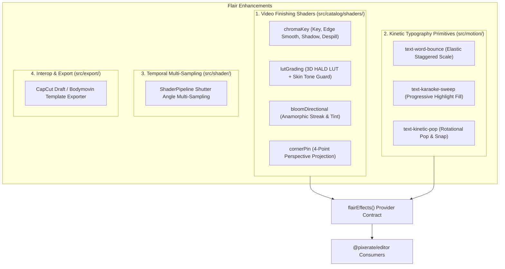

# Video Post-Production & Motion Synergy Plan: CapCut REA Insights for Flair

## Executive Summary
This document outlines an actionable enhancement roadmap for **Flair** (`@pixerate/flair`), derived from empirical reverse-engineering of `/Applications/CapCut.app` (v9.5.0, `libvideoeditor.dylib`, `libVECreator.dylib`, `QtBodymovin.framework`, and builtin AI agent copilot skills).

As `@pixerate/editor`'s upstream provider for shaders, vector graphics, and motion synthesis, Flair is uniquely positioned to implement production video finishing shaders, kinetic typography primitives, shutter-angle motion blur, and video interchange formats.

---

## 1. Background & Empirical Evidence from CapCut

Reverse-engineering `/Applications/CapCut.app/Contents/Frameworks/libvideoeditor.dylib` revealed key architectural patterns in how modern desktop video editors structure visual effects, typography, and motion:

1. **Color Finishing & Skin Tone Protection**:
   - `KFTypeLUTSkin`, `materialIsVaildToUseLut`, and `algorithmConfig.json`'s `skin_seg` (skin segmentation) pipeline node.
   - Heavy creative LUTs (Teal/Orange, Noir, Vintage) are blended through an automatic skin-chroma protection mask to prevent discoloration of human subjects.
2. **Production Green Screen / Chroma Keying**:
   - `KFTypeChromaIntensity`, `KFTypeChromaShadow`, `KFTypeChromaSpill`, and `KFTypeChromaEdgeSmooth`.
   - Comprehensive chroma keying involves not just alpha masking, but despill color suppression and edge shadow preservation.
3. **Anamorphic Streaks & Directional Lighting**:
   - `KFTypeBloomStrength`, `KFTypeBloomRange`, `KFTypeBloomColor`, `KFTypeBloomDirX/Y`, and `KFTypeLightSource*`.
   - Bloom in video production is directional (horizontal anamorphic streaks) with adjustable thresholds and tint.
4. **Kinetic Caption Typography & Lyric Effects**:
   - `TextClient::addLyricEffect`, `aigc_text_template`, with word-by-word timing (`word_start_time`, `word_end_time`), spring bounces, and highlight wipes.
5. **Temporal Motion Blur Synthesis**:
   - `MotionBlurService`, `previewMotionBlur`, and `startLyricEffectMotionBlur`.
   - High-velocity motion (speed ramping, kinetic titles) synthesizes multi-sample temporal blur matching camera shutter angles (0–360°).
6. **Bodymovin & Project Draft Interchanges**:
   - Heavy reliance on Bodymovin / Lottie (`QtBodymovin.framework`) for animated graphics templates, and structured JSON drafts (`draft_info.json`).

---

## 2. Proposed Flair Capabilities & Architecture



---

## 3. Phased Implementation Plan

### Phase 1: Video Finishing & Keying Shaders (`src/catalog/shaders/`)

#### 1.1 Chroma Key & Despill (`src/catalog/shaders/treatments.ts`)
- **ID**: `image-chroma-key`
- **Category**: `image` / `video: "filter"`
- **Inputs & Controls**:
  - `uKeyColor`: Target backdrop color (default `#00FF00`).
  - `uSimilarity`: Color distance threshold in YCbCr/Lab color space (min 0, max 1, default 0.35).
  - `uSmoothness`: Edge softness transition ramp (min 0, max 0.5, default 0.1).
  - `uDespill`: Spill suppression strength replacing bounced green/blue reflections on hair and skin with neutral luminance (min 0, max 1, default 0.8).
  - `uShadowPreserve`: Retains natural floor and backdrop contact shadows (min 0, max 1, default 0.2).
- **Presets**: `Green screen studio`, `Blue screen exterior`, `Soft spill reduction`.

#### 1.2 Skin-Protected 3D LUT Color Grading (`src/catalog/shaders/treatments.ts`)
- **ID**: `image-lut-grade`
- **Category**: `image` / `video: "filter"`
- **Inputs & Controls**:
  - `uLut`: 2D/3D HALD LUT sampler (`sampler2D` default HALD-16 or HALD-32 base map).
  - `uIntensity`: Overall grading blend strength (min 0, max 1, default 1.0).
  - `uPreserveSkinTones`: Protects human skin tones from heavy color grading shifts (min 0, max 1, default 0.7).
  - `uSkinHue`: Center hue angle for skin ellipse (default 25°).
  - `uSkinWidth`: Angular width for skin chroma detection (default 20°).
- **Algorithm**:
  1. Computes graded color via trilinear HALD interpolation: $C_{lut} = \text{sampleLut}(C_{src})$.
  2. Evaluates skin chroma probability $w_{skin} \in [0, 1]$ using an elliptical falloff in YCbCr color space.
  3. Mixes graded output with original color: $C_{out} = \text{mix}(C_{lut}, \text{mix}(C_{lut}, C_{src}, uPreserveSkinTones), w_{skin})$.
- **Presets**: `Teal & Orange (Protected Face)`, `Punchy Contrast`, `Faded Film Noir`.

#### 1.3 Directional Anamorphic Bloom (`src/catalog/shaders/glow.ts`)
- **ID**: `bloom-directional`
- **Category**: `glow` / `video: "filter"`
- **Inputs & Controls**:
  - `uThreshold`: Luminance threshold for bloom extraction (min 0, max 1, default 0.75).
  - `uAngle`: Directional streak angle in degrees (min 0, max 360, default 0 / horizontal).
  - `uSpread`: Streak reach along the angle vector (min 0, max 1, default 0.6).
  - `uTint`: Anamorphic streak color tint (default `#2DD4FF` electric blue).
  - `uIntensity`: Multiplicative boost (min 0, max 4, default 1.5).

#### 1.4 Corner Pin / 4-Point Homography Projection (`src/catalog/shaders/distortion.ts`)
- **ID**: `corner-pin`
- **Category**: `distortion` / `video: "filter"`
- **Inputs & Controls**:
  - `uTopLeft`, `uTopRight`, `uBottomLeft`, `uBottomRight`: 2D corner coordinates normalized [0, 1].
- **Algorithm**: Inverse projective mapping (homography matrix solve) from destination pixel to source coordinate with bilinear sampling.

---

### Phase 2: Kinetic Typography Motion Primitives (`src/motion/`)

Extend `src/motion/library.ts` with word- and segment-level kinetic primitives designed for captions and title cards:

#### 2.1 `text-word-bounce`
- **Description**: Staggered elastic bounce-in applied to SVG `<text>` spans or grouped word nodes.
- **Parameters**: `staggerMs` (delay between consecutive words), `springDamping`, `overshootScale` (default 1.15).

#### 2.2 `text-karaoke-sweep`
- **Description**: Progressive left-to-right highlight color wipe across spoken words synchronized to speech timestamps.
- **Parameters**: `activeColor` (highlight fill, e.g. `#FACC15`), `baseColor` (inactive text, e.g. `#FFFFFF`), `strokeColor` (contrast outline).

#### 2.3 `text-kinetic-pop`
- **Description**: High-impact word pop with brief micro-rotation ($\pm 4^\circ$) and rapid snap into rest pose, popular in TikTok/Reels captions.

---

### Phase 3: Shutter-Angle Temporal Motion Blur (`src/shader/pipeline.ts`)

#### 3.1 Multi-Sample Temporal Accumulation
- Extend `ShaderPipeline` and `ScenePlayer` to support an optional `shutterAngle` (0–360°, default 0):
  ```typescript
  export interface RenderFrameOptions {
    timeMs: number;
    shutterAngle?: number; // 0 to 360 degrees
    samples?: number; // 4 to 16 temporal sub-frames
  }
  ```
- **Execution**:
  - When $shutterAngle > 0$ during rendering/recording:
    - Calculates exposure window: $\Delta t = \frac{1}{\text{fps}} \cdot \frac{shutterAngle}{360}$.
    - Evaluates $N$ jittered sub-frame samples across $[t, t + \Delta t]$ into an accumulation texture with weighted averaging.
  - Eliminates strobing on rapid transforms, camera sweeps, and spinning kinetic elements in exported video.

---

### Phase 4: CapCut Project & Template Interoperability (`src/export/`)

#### 4.1 CapCut Bodymovin Template Exporter (`src/export/capcut-template.ts`)
- CapCut stores animated title templates in `aigc_text_template/content.json` using Bodymovin/Lottie layers enriched with font and bounding box metadata.
- Provide `exportCapCutTextTemplate(scene: Scene, options): string` converting a Flair typography scene into CapCut's native template JSON format.

---

## 4. Verification & Testing Plan

1. **Shader Compilation & GPU Benchmark**:
   - Verify all new shaders compile clean on real WebGL2 targets:
     ```bash
     pnpm dev # check http://localhost:3100/#check
     ```
   - Benchmark execution time to guarantee < 4ms per frame at 1080p:
     ```bash
     pnpm dev # bench http://localhost:3100/#bench?only=image-chroma-key,image-lut-grade,bloom-directional
     ```
2. **Unit Tests**:
   - `src/catalog/catalog.test.ts`: Ensure new shaders validate against controls schemas and generate proper presets.
   - `src/motion/motion.test.ts`: Test SVG text motion primitives and timing calculation.
   - `src/export/node-export.test.ts`: Test headless rendering and export with temporal accumulation.
3. **Workspace Conformance**:
   ```bash
   pnpm typecheck
   pnpm test
   pnpm build
   ```
